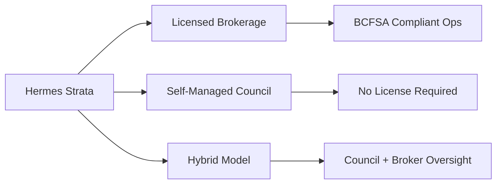

# Hermes Strata — Roadmap & Paths

---

## Go-To-Market Paths

| Path | License | Hermes Role | Revenue |
|------|---------|-------------|---------|
| Licensed Brokerage | BCFSA brokerage + Managing Broker | White-label ops platform | $4–6/unit × portfolio |
| Self-Managed | None (owners manage themselves) | Direct SaaS | $4/unit or $200/bldg flat |
| Hybrid | Broker for trust/forms only | Council day-to-day + broker oversight | Split pricing |

---

## Timeline

### Phase 1 — Foundation ✅ (Jul 2026)
Marketing site, compliance KB, Strata Tool hub, docs, graphs

### Phase 2 — Supercharge (Jul–Aug 2026) ✅ COMPLETE
About page, roadmap, building template wizard, FAQ, RSS feed, full interface localization, passing typecheck, e-transfer auto-reconciliation prototype (verified on `/tools`, brief/full modes, CSV import seam, live-unit wiring)

### Phase 3 — Core Product (Q3 2026) 🔄 IN PROGRESS
Docker stack (Rosa + Ziggy + Postgres/pgvector) scaffolded in `backend/`, immutable multi-account trust ledger (append-only, hash-chain diffable), fee billing, Form B/F API, bylaw state machine, PWA. Backend core services live and tested.

**Completed in this run:** Rosa pgvector/Ollama retriever wired (migration `0002` + `vectorRetriever` — real embeddings when pgvector+Ollama are reachable, keyword fallback otherwise, same `Retriever` contract, same `composeAnswer` strictness); Rosa corpus → pgvector indexer (`backend/src/rosa/ingest-vector.ts` — embeds the BC corpus with Ollama `/api/embeddings`, upserts into `corpus_chunk`, idempotent per citation; `rosa index` CLI to write it, `rosa reset` dev helper); Ziggy PSBT broadcast + on-chain reconcile seam complete (`broadcastPsbt` + `postSpendToLedger` + `POST /api/v1/treasury/psbt/broadcast` — marks ready plans broadcasted, posts the debit to the trust ledger so the on-chain leg reconciles into the same hash chain); Ziggy on-chain broadcast plug-in seam complete (`backend/src/ziggy/node-broadcast.ts` — both node paths: the BIP174 PSBT workflow seam `walletprocesspsbt → finalizepsbt → sendpsbt` (never fabricates; hardware-wallet aggregated PSBTs pass straight through) with the raw-tx `sendrawtransaction` seam as the watch-only fallback; the broadcast endpoint tries the workflow first when `BITCOIN_RAIL_ENABLED=true` + `BITCOIN_NODE_URL` + rpc auth are set and returns the real txid); deployment docs rewritten for Tailscale-first, per-user-tailnet self-hosting (any operator brings their own Tailscale; API at host MagicDNS name; Postgres never public) + a self-contained onboarding doc (`docs/TAILSCALE-ONBOARDING.md`) that any operator can follow to stand up the backend on their own host.

**Remaining:** deploy the stack on a Tailscale host (`docker compose up -d`, `AUTH_SECRET`, migrate, e2e smoke gate — see `docs/TAILSCALE-ONBOARDING.md`), provision Rosa Ollama + run `rosa index` to populate `corpus_chunk`, provision Bitcoin rails daemons (bitcoind/LND/Liquid/PayNym/Nostr) and enable them in `.env` so `/treasury/psbt/broadcast` returns a real txid and `payments/confirm` → real broadcast.

**The infrastructure already exists (2026-09-18):** THOR, the family VPS that runs the HERMES agent, carries a **pruned Bitcoin node + LND reachable over Tailscale**; Cam separately owns an **UMBREL full node still syncing (~63% IBD, ETA weeks)**; M3, M4, THOR and UMBREL are all Tailscale peers. So the bitcoind/LND half of the remaining work is a matter of *pointing the seams*, not building nodes.

**Decision:** **THOR's pruned node is the MVP rail** — broadcast and confirm need no historical rescan, so `sendrawtransaction`, the PSBT workflow seam and UTXO watching all work. **UMBREL is the correctness backstop**, not a blocker: it is the only node that can answer "does this address have old history?". Until its IBD finishes, watch-only xpub imports may show a **partial** history, which the UI must label honestly rather than present as a complete ledger. Nothing waits on UMBREL — re-pointing at it later is a config change (`BITCOIN_NODE_URL`), because the seams are address-agnostic.

Still open: LND reachability + macaroon (read-only vs admin), THOR's prune target and chain, whether THOR's bitcoind is **wallet-enabled** (the PSBT workflow needs a node-side wallet; LND's is separate), THOR's Docker/Tailscale/Node toolchain, Ollama + `nomic-embed-text`, stable MagicDNS names, disk/RAM headroom, and Tailscale ACLs for the API and RPC ports. Questions recorded in `docs/KIMI-HANDOFF.md` and tabulated in `docs/DEPLOYMENT.md` ("Nodes, hosts & the tailnet").

### Phase 4 — Sovereign (Q4 2026)
Satohash integration, Lightning, Nostr identity, multisig watch, CRT export

### Phase 5 — Scale (2027)
Brokerage multi-building, bank feeds, war chest, agent pay, ON/AB packs

### Phase 6 — International (2028)
US HOA (WA, FL, CA), EU multi-language, OpenStrata protocol adoption

---

## Evergreen House — shipped 2026-09-30

The readable workspace on the v0.3.28 shell. Strata plan LMS 2847, 4100 Cambie Street, 4 floors, 40 lots, books as of September 30, 2026. Pages: `/units`, `/accounting`, `/pay`, `/tax`, `/calendar`, `/meetings`. E-transfer, Bitcoin, and Lightning stay on screen. Payment destinations are not payable. The tax desk is a sample, not a filing and not tax advice. The 40-lot story lives in `src/lib/demo/`. Do not replace the 6-lot `demoUnits` seed in `src/lib/units.ts`.

The same queue is on the public page `/roadmap`.

## UI refinement — standing rule

The interface keeps being refined as the product grows. This queue is not a one-time list.

After every push that changes what a person sees:

1. Offer exactly four concrete UI upgrades.
2. Wait. Cam picks one or two.
3. The next session polishes only those picks.
4. When a pick ships, replace it so four are always waiting.

Do not start a queued item before it is picked. Do not treat the queue as finished.

### Offered 2026-10-28 — refreshed again, not started

1. **A receipt you can hand over** (`/pay`). One printed page per payment: the amount, the rail, the reference or txid, the rate at lock and the lot, on council letterhead, checked at print size. Today the receipt tape is on screen only.
2. **Search that reaches the workspace** (`Cmd/Ctrl+K`). The index finds pages and documents today, not the building. Add lot records, ledger entries and tax sections, each result opening the row it names.
3. **A budget that prints** (`/accounting`). One printed page per budget, line by line: the annual figure, the year to date, what is left and the variance, so a council can review the plan against the actuals on paper. The Budget tab is on screen only, and the variance is not on it.
4. **The year's deadlines on one page** (`/calendar`). Twelve months of the fiscal year on one printable grid, each statutory window shaded and the tracked items listed beneath, so a council can pin the year to the wall instead of paging through months.

### Shipped

- **A year on one page, and the AGM packet to hand out** (`/`, `/meetings`, v0.3.50) — offered 2026-10-28, **picked by Cam**, shipped 2026-10-28. The dashboard ends in an annual sheet for the AGM package: income and spend by category with their totals and budget column, the three fund balances and their **$717,034.42** total, the score from **April's 82 to September's 56**, and all three tracked items with their day counts. `src/lib/year-sheet.ts` (9 tests) reads every figure from the books rather than retyping it, leaves the CRF contribution out of the operating surplus because a dollar moved to the reserve is still the owners' money, reports a ledger code no category claims instead of dropping it, and keeps an overdue item under an overdue count rather than deleting it. The score is passed in from the dashboard's own six points, so a Form K filing reaches the paper and the gauge together. `/meetings` prints a packet instead of a workspace: notice, agenda, last minutes and the quorum maths on one page, with **20 October's notice due 13 October (7 days ahead)**, quorum **3 of 5**, and the AGM on 19 May 2027 at **14 of 40**. `src/lib/meeting-packet.ts` (5 tests) computes the last lawful day from the statutory window, treats a late notice as late, and reads quorum as a majority of seats (3 of 5, and 3 of 4). Making the paper found two print defects: the app's screen gutters on top of the `@page` margin ran the annual sheet onto a second, blank sheet, and a 176 mm sheet was clipped on the right because two score tables' min-content width pushed past the paper — `minmax(0, 1fr)` and a fixed table layout wrap the cells instead. 52 catalog keys × 9 locales (1,513 at parity), 535 frontend tests (27 new), both pages printed to A4 PDF in Chrome and read back at page size. The two picked slots are replaced, so four are waiting.

- **The reserve fund's five-year picture** (`/accounting`, v0.3.49) — offered 2026-10-28, **picked by Cam**, shipped 2026-10-28. A new **Reserve plan** tab carries the CRF five fiscal years forward: opening balance, the budget's contribution, the interest the credit union actually paid, the projects the depreciation report schedules, and the balance each 31 March ends on. `src/lib/reserve-plan.ts` (9 tests) holds four rules. The contribution is the budget's $43,200, never the report's recommended $48,000 — projecting a recommendation would draw a fund the building does not have, so the page states the gap instead. Interest is the 0.74% the statements actually paid, on the average balance, and a year that ends below zero earns nothing. A project named for a calendar year is paid in the fiscal year that ends in it, so the 2029 elevator lands in 2028–29 rather than twelve months early. And the parkade membrane stays out of the CRF: the levy collected and spent it in its own trust. The result is allowed to be negative, and it is: the roof in 2030–31 leaves the fund **$133,291.62 short**, which the page leads with. Four route tests; 17 catalog keys × 9 locales (1,461 at parity). The picked slot is replaced, so four are waiting.
- **The Form K register** (`/units/register`, v0.3.48) — offered 2026-10-28, **picked by Cam**, shipped 2026-10-28. One printable page for the tenanted lots: the day each two-week window closed, whether the form is on file, how many days a missing one has been missing, and the points it costs the score — longest-open first, so a reader works from the top. `src/lib/form-k-register.ts` (9 tests) imports the per-gap charge and the 15-point cap from `health.ts` rather than restating them, so a row's points and the gauge's cannot drift; a window still open is listed but costs nothing (scored at 10 September, lots 209 and 407 have no gap), and once the cap is reached the extra gaps say they cost nothing instead of pretending. A filing recorded on a lot’s own sheet closes its gap from the day it was recorded, so August keeps the 72 it earned. Five route tests prove the page reads that model, not a copy of it. 19 catalog keys × 9 locales (1,442 at parity). The picked slot is replaced, so four are waiting.
- **The funds follow the month, and a Form K can be filed** (`/accounting`, `/units/309`, v0.3.47) — requested directly by Cam, outside the queue, following on from `0.3.46`. The funds tab carries the credit union's six month-end statements (operating, reserve, parkade levy, the three added, and the change since the month before), closing on the figures the rest of the books report ($81,797.62 + $603,688.80 + $31,548.00 = $717,034.42). With `?period=2026-04` open the cards read **Cash at April 30, 2026** ($47,583.16 / $590,000.00 / $177,948.00) and the page says which lines are still the September 30 close; a month the bank has not closed falls back to the close and says so rather than interpolating. `src/lib/demo/cash.ts` holds the statements as records and `src/lib/fund-history.ts` the arithmetic, 6 tests — September pinned to the funds tab, the levy's 1 April balance pinned to the collection, six changes adding to the year's movement. The second half records a Form K on the lot's sheet: a date field at `/units/309#forms`, stored on this device, the card reading “On file — recorded 2026-09-30 in this browser”, and the score reading it — three gaps become two and September's point 56 → 61 while August stays 72, because a filing counts only from its own day (`src/lib/form-k.ts`, 6 tests). The `/units` filter and the plan's tones read the same record. 12 catalog keys × 9 locales (1,422 at parity), 481 frontend tests.
- **Aged arrears and a lot's own sheet** (`/accounting`, `/units/207`, v0.3.45) — the two picks from the 2026-10-28 offer, shipped together. The receivables tab is an aging ladder: every charge aged from the day it fell due, current / 1–30 / 31–60 / 61–90 / 90+, oldest money first, each row opening that lot's sheet. `src/lib/arrears.ts` (19 tests) holds three decisions — ages come from due dates rather than a status field, a payment plan is a schedule and sits outside the ladder by its own amount (lots 108 and 403), and "current" means not yet due, so the October fee is in the total and in the column that should be empty before the 1st. Every charge list adds to `balance(unit).total`, lot by lot, which is a test. `src/lib/lot-sheet.ts` (15 tests) reads one lot as a statement: `/units/[lot]` is a real page for all 40 lots, with the account from April to September against what cleared it, the levy at the resolution that created it, the forms on file, what is dated next, and a print that leaves the tenancy off it. Three defects were found by looking: the footer totalled the book while three rows were on screen, the "nothing past due" count said 37 of 37 lots, and a future item printed `in −1 days`. Two new offers replace the two picks, so four are waiting.
- **The floor plan and the statement** (`/units`, `/accounting`, v0.3.44) — both picked from the 2026-10-28 offer, shipped together. `/units` draws the building instead of listing it: four bands, top floor first, two rows of lots either side of a corridor, each lot as wide as its square footage earns and coloured by the same tone rule the filters use. `src/lib/floor-plan.ts` (11 tests) holds the split and the widths — every row adds to exactly 100 after rounding, with a 14% floor under the small studios so a lot keeps its own number. A grid item's default `min-width: auto` had pushed a 390px phone to 502px; the plan column is `min-w-0` now and the band is the only thing that scrolls. `/accounting`'s journal reads as a statement: date order, a cash balance beside every entry, and a drawer per entry with its hash, who posted it and the evidence behind it. `src/lib/ledger-statement.ts` (11 tests) names the two bank accounts rather than matching a `10xx` prefix — the first draft swept the war chest at cost (1080) into the balance and moved it by $405 it never saw — and the hashes are chained, so an edited line changes every hash below. The last line lands on $685,486.42, which is the operating plus reserve cash on Three funds. Two new offers replace the two picks, so four are waiting.
- **The release trail** (`/changelog`, v0.3.43) — picked from the 2026-10-16 offer. The page opens with the build you are running and how far it is from the newest note, marks the running release, and gives every release a step naming the one it followed and counting what it changed. Rules in `src/lib/release-trail.ts` (11 tests): versions compare as numbers (`0.3.9` before `0.3.10`), and a build whose version has no note is a stated state rather than a marker pointing at the wrong release. Verified in all three states in a browser by moving `package.json`. Three new offers replaced it, so four are waiting again.
- **The next 30 days, once** (`/tax` and `/calendar`, v0.3.41) — picked from the 2026-10-16 offer. One strip over the calendar the rest of the app already reads, grouped Today / This week / Later this month, with a tax-narrowed window on `/tax`.
- **September close** (`/accounting`, v0.3.40) — picked from the 2026-10-16 offer. Five checks read from the ledger rather than a status field, with the blocking one named on the disabled button.
- **The dashboard panel audit** (v0.3.39) — requested directly, outside the queue. Every panel measured at `1440`–`620` in both themes; the compliance-health card was cutting the deadline titles it scores (`Ener…` at 1100), so the gauge, the formula and the items now stack and each title clamps to two lines. The task list's titles clamp the same way. Everything else measured clean, including the tab rows and payment strip that are meant to scroll. Queue still untouched.
- **The dashboard's closing cards** (v0.3.38) — requested directly by Cam, outside the queue. The three proof cards above the footer had their copy capped at `28ch` (~145px at `9.5px`) while a nowrap link took the rest of the card and `overflow: hidden` hid what did not fit. They are now a two-row grid per card: icon beside the copy, link on its own baseline underneath, type at `12.5/10.5px`, three columns only while the measure stays readable, two-up with the third spanning under `1180px`, one per row under `620px`. The queue is untouched — still the four below, none picked.
- **The signed owner payment link** (`/pay`, v0.3.32) — requested directly by Cam, outside the queue. A treasurer issues one signed link per bill and the owner pays from it with **no council login**: `/pay?unit=305&rail=etransfer&t=…` verifies the token at the host and renders **the council's bill** (amount, reference, payee, expiry), with the lot fixed and no other owner's data on the page. The same token is accepted by the Interac request and status routes in place of a session, and the host takes the amount, lot, reference and payee **from the link's claims**, so the payer's page cannot change them. Rules in `backend/src/rails/pay-link.ts` (14 tests) and the sheet helpers in `src/lib/pay-sheet.ts`; 17 backend + 6 frontend tests. Found on the way: a refusal that answered `200`, a gateway check that threw on a missing URL, and `127.0.0.1` being treated as less local than `localhost`.
- **One-lot pay sheet** (`/pay`) — offered 2026-09-30, **picked by Cam**, shipped 2026-10-16 in v0.3.30. One amount, three large choices, the 15-minute rate lock as a quiet stamp, PAD and cheque tucked under the sheet. The queue was renumbered and one item added, so four are waiting again. **Follow-up that shipped with it (v0.3.31):** the e-transfer panel now carries an Interac button that starts a **Business Request Money** request with the amount and reference already in it and hands the payer to Interac to pick their own bank and approve — live on a council host whose financial institution onboarded it, and a labelled simulation everywhere else (Interac issues that credential through a participating institution, not to a website). Rules in `src/lib/interac.ts` (26 tests), the institutional seam in `backend/src/rails/interac.ts` with three routes and 21 tests.

---

## Jurisdiction Expansion

| Order | Region | Law Pack | Status |
|-------|--------|----------|--------|
| 1 | BC | SPA, RTA, EPR | **Live** |
| 2 | ON | Condo Act | Planned |
| 3 | AB | Condo Act | Planned |
| 4 | US-WA | RCW 64.34 | Planned |
| 5 | US-FL/CA | HOA/CC&R | Planned |
| 6 | EU | Multi-lang | Planned |

Config-driven via `config.yaml` — one codebase, swap law packs.

---

## Integration Dependencies

| Partner | Status | Integration Point |
|---------|--------|-------------------|
| Satohash | In progress (v4.1) | OTS stamping API |
| OpenStrata | Spec phase | Nostr export format |
| Umbrel/Tailscale | Ready | Local-first hosting |
| Unchained/Casa | Future | Multisig provider option |
| BCFSA | N/A (regulator) | Audit-ready exports |

---
**Diligence pack:** [docs/diligence/](diligence/) (investor + architecture + ask)
