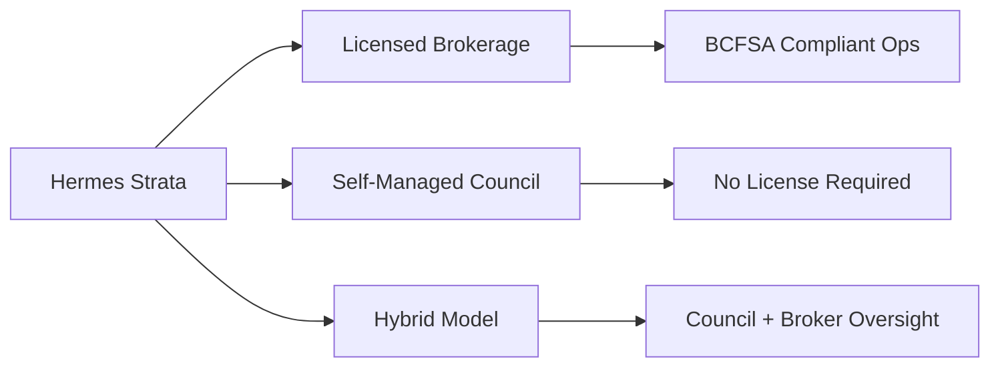

# Hermes Strata — Roadmap & Paths

---

## Go-To-Market Paths

| Path | License | Hermes Role | Revenue |
|------|---------|-------------|---------|
| Licensed Brokerage | BCFSA brokerage + Managing Broker | White-label ops platform | $4–6/unit × portfolio |
| Self-Managed | None (owners manage themselves) | Direct SaaS | $4/unit or $200/bldg flat |
| Hybrid | Broker for trust/forms only | Council day-to-day + broker oversight | Split pricing |

---

## Timeline

### Phase 1 — Foundation ✅ (Jul 2026)
Marketing site, compliance KB, Strata Tool hub, docs, graphs

### Phase 2 — Supercharge (Jul–Aug 2026) ✅ COMPLETE
About page, roadmap, building template wizard, FAQ, RSS feed, full interface localization, passing typecheck, e-transfer auto-reconciliation prototype (verified on `/tools`, brief/full modes, CSV import seam, live-unit wiring)

### Phase 3 — Core Product (Q3 2026) 🔄 IN PROGRESS
Docker stack (Rosa + Ziggy + Postgres/pgvector) scaffolded in `backend/`, immutable multi-account trust ledger (append-only, hash-chain diffable), fee billing, Form B/F API, bylaw state machine, PWA. Backend core services live and tested.

**Completed in this run:** Rosa pgvector/Ollama retriever wired (migration `0002` + `vectorRetriever` — real embeddings when pgvector+Ollama are reachable, keyword fallback otherwise, same `Retriever` contract, same `composeAnswer` strictness); Rosa corpus → pgvector indexer (`backend/src/rosa/ingest-vector.ts` — embeds the BC corpus with Ollama `/api/embeddings`, upserts into `corpus_chunk`, idempotent per citation; `rosa index` CLI to write it, `rosa reset` dev helper); Ziggy PSBT broadcast + on-chain reconcile seam complete (`broadcastPsbt` + `postSpendToLedger` + `POST /api/v1/treasury/psbt/broadcast` — marks ready plans broadcasted, posts the debit to the trust ledger so the on-chain leg reconciles into the same hash chain); Ziggy on-chain broadcast plug-in seam complete (`backend/src/ziggy/node-broadcast.ts` — both node paths: the BIP174 PSBT workflow seam `walletprocesspsbt → finalizepsbt → sendpsbt` (never fabricates; hardware-wallet aggregated PSBTs pass straight through) with the raw-tx `sendrawtransaction` seam as the watch-only fallback; the broadcast endpoint tries the workflow first when `BITCOIN_RAIL_ENABLED=true` + `BITCOIN_NODE_URL` + rpc auth are set and returns the real txid); deployment docs rewritten for Tailscale-first, per-user-tailnet self-hosting (any operator brings their own Tailscale; API at host MagicDNS name; Postgres never public) + a self-contained onboarding doc (`docs/TAILSCALE-ONBOARDING.md`) that any operator can follow to stand up the backend on their own host.

**Remaining:** deploy the stack on a Tailscale host (`docker compose up -d`, `AUTH_SECRET`, migrate, e2e smoke gate — see `docs/TAILSCALE-ONBOARDING.md`), provision Rosa Ollama + run `rosa index` to populate `corpus_chunk`, provision Bitcoin rails daemons (bitcoind/LND/Liquid/PayNym/Nostr) and enable them in `.env` so `/treasury/psbt/broadcast` returns a real txid and `payments/confirm` → real broadcast.

**The infrastructure already exists (2026-09-18):** THOR, the family VPS that runs the HERMES agent, carries a **pruned Bitcoin node + LND reachable over Tailscale**; Cam separately owns an **UMBREL full node still syncing (~63% IBD, ETA weeks)**; M3, M4, THOR and UMBREL are all Tailscale peers. So the bitcoind/LND half of the remaining work is a matter of *pointing the seams*, not building nodes.

**Decision:** **THOR's pruned node is the MVP rail** — broadcast and confirm need no historical rescan, so `sendrawtransaction`, the PSBT workflow seam and UTXO watching all work. **UMBREL is the correctness backstop**, not a blocker: it is the only node that can answer "does this address have old history?". Until its IBD finishes, watch-only xpub imports may show a **partial** history, which the UI must label honestly rather than present as a complete ledger. Nothing waits on UMBREL — re-pointing at it later is a config change (`BITCOIN_NODE_URL`), because the seams are address-agnostic.

Still open: LND reachability + macaroon (read-only vs admin), THOR's prune target and chain, whether THOR's bitcoind is **wallet-enabled** (the PSBT workflow needs a node-side wallet; LND's is separate), THOR's Docker/Tailscale/Node toolchain, Ollama + `nomic-embed-text`, stable MagicDNS names, disk/RAM headroom, and Tailscale ACLs for the API and RPC ports. Questions recorded in `docs/KIMI-HANDOFF.md` and tabulated in `docs/DEPLOYMENT.md` ("Nodes, hosts & the tailnet").

### Phase 4 — Sovereign (Q4 2026)
Satohash integration, Lightning, Nostr identity, multisig watch, CRT export

### Phase 5 — Scale (2027)
Brokerage multi-building, bank feeds, war chest, agent pay, ON/AB packs

### Phase 6 — International (2028)
US HOA (WA, FL, CA), EU multi-language, OpenStrata protocol adoption

---

## Evergreen House — shipped 2026-09-30

The readable workspace on the v0.3.28 shell. Strata plan LMS 2847, 4100 Cambie Street, 4 floors, 40 lots, books as of September 30, 2026. Pages: `/units`, `/accounting`, `/pay`, `/tax`, `/calendar`, `/meetings`. E-transfer, Bitcoin, and Lightning stay on screen. Payment destinations are not payable. The tax desk is a sample, not a filing and not tax advice. The 40-lot story lives in `src/lib/demo/`. Do not replace the 6-lot `demoUnits` seed in `src/lib/units.ts`.

The same queue is on the public page `/roadmap`.

## UI refinement — standing rule

The interface keeps being refined as the product grows. This queue is not a one-time list.

After every push that changes what a person sees:

1. Offer exactly four concrete UI upgrades.
2. Wait. Cam picks one or two.
3. The next session polishes only those picks.
4. When a pick ships, replace it so four are always waiting.

Do not start a queued item before it is picked. Do not treat the queue as finished.

### Offered 2026-10-28 — refreshed, not started

1. **Aged arrears** (`/accounting`). The receivables tab as an aging ladder — current, 30, 60 and 90+ days — oldest money first, each row opening the lot it names.
2. **A lot's own sheet** (`/units?lot=305`). One lot on one page: the balance, its own ledger, the forms issued, the next dated items, and a print that keeps the tenant off it.
3. **Search that reaches the workspace** (`Cmd/Ctrl+K`). The index finds pages and documents today, not the building. Add lot records, ledger entries and tax sections, each result opening the row it names.
4. **The AGM packet** (`/meetings`). One printable packet per meeting: the notice, the agenda, the last minutes and the quorum maths on one page, checked at print size rather than shrunk to fit.

### Shipped

- **The floor plan and the statement** (`/units`, `/accounting`, v0.3.44) — both picked from the 2026-10-28 offer, shipped together. `/units` draws the building instead of listing it: four bands, top floor first, two rows of lots either side of a corridor, each lot as wide as its square footage earns and coloured by the same tone rule the filters use. `src/lib/floor-plan.ts` (11 tests) holds the split and the widths — every row adds to exactly 100 after rounding, with a 14% floor under the small studios so a lot keeps its own number. A grid item's default `min-width: auto` had pushed a 390px phone to 502px; the plan column is `min-w-0` now and the band is the only thing that scrolls. `/accounting`'s journal reads as a statement: date order, a cash balance beside every entry, and a drawer per entry with its hash, who posted it and the evidence behind it. `src/lib/ledger-statement.ts` (11 tests) names the two bank accounts rather than matching a `10xx` prefix — the first draft swept the war chest at cost (1080) into the balance and moved it by $405 it never saw — and the hashes are chained, so an edited line changes every hash below. The last line lands on $685,486.42, which is the operating plus reserve cash on Three funds. Two new offers replace the two picks, so four are waiting.
- **The release trail** (`/changelog`, v0.3.43) — picked from the 2026-10-16 offer. The page opens with the build you are running and how far it is from the newest note, marks the running release, and gives every release a step naming the one it followed and counting what it changed. Rules in `src/lib/release-trail.ts` (11 tests): versions compare as numbers (`0.3.9` before `0.3.10`), and a build whose version has no note is a stated state rather than a marker pointing at the wrong release. Verified in all three states in a browser by moving `package.json`. Three new offers replaced it, so four are waiting again.
- **The next 30 days, once** (`/tax` and `/calendar`, v0.3.41) — picked from the 2026-10-16 offer. One strip over the calendar the rest of the app already reads, grouped Today / This week / Later this month, with a tax-narrowed window on `/tax`.
- **September close** (`/accounting`, v0.3.40) — picked from the 2026-10-16 offer. Five checks read from the ledger rather than a status field, with the blocking one named on the disabled button.
- **The dashboard panel audit** (v0.3.39) — requested directly, outside the queue. Every panel measured at `1440`–`620` in both themes; the compliance-health card was cutting the deadline titles it scores (`Ener…` at 1100), so the gauge, the formula and the items now stack and each title clamps to two lines. The task list's titles clamp the same way. Everything else measured clean, including the tab rows and payment strip that are meant to scroll. Queue still untouched.
- **The dashboard's closing cards** (v0.3.38) — requested directly by Cam, outside the queue. The three proof cards above the footer had their copy capped at `28ch` (~145px at `9.5px`) while a nowrap link took the rest of the card and `overflow: hidden` hid what did not fit. They are now a two-row grid per card: icon beside the copy, link on its own baseline underneath, type at `12.5/10.5px`, three columns only while the measure stays readable, two-up with the third spanning under `1180px`, one per row under `620px`. The queue is untouched — still the four below, none picked.
- **The signed owner payment link** (`/pay`, v0.3.32) — requested directly by Cam, outside the queue. A treasurer issues one signed link per bill and the owner pays from it with **no council login**: `/pay?unit=305&rail=etransfer&t=…` verifies the token at the host and renders **the council's bill** (amount, reference, payee, expiry), with the lot fixed and no other owner's data on the page. The same token is accepted by the Interac request and status routes in place of a session, and the host takes the amount, lot, reference and payee **from the link's claims**, so the payer's page cannot change them. Rules in `backend/src/rails/pay-link.ts` (14 tests) and the sheet helpers in `src/lib/pay-sheet.ts`; 17 backend + 6 frontend tests. Found on the way: a refusal that answered `200`, a gateway check that threw on a missing URL, and `127.0.0.1` being treated as less local than `localhost`.
- **One-lot pay sheet** (`/pay`) — offered 2026-09-30, **picked by Cam**, shipped 2026-10-16 in v0.3.30. One amount, three large choices, the 15-minute rate lock as a quiet stamp, PAD and cheque tucked under the sheet. The queue was renumbered and one item added, so four are waiting again. **Follow-up that shipped with it (v0.3.31):** the e-transfer panel now carries an Interac button that starts a **Business Request Money** request with the amount and reference already in it and hands the payer to Interac to pick their own bank and approve — live on a council host whose financial institution onboarded it, and a labelled simulation everywhere else (Interac issues that credential through a participating institution, not to a website). Rules in `src/lib/interac.ts` (26 tests), the institutional seam in `backend/src/rails/interac.ts` with three routes and 21 tests.

---

## Jurisdiction Expansion

| Order | Region | Law Pack | Status |
|-------|--------|----------|--------|
| 1 | BC | SPA, RTA, EPR | **Live** |
| 2 | ON | Condo Act | Planned |
| 3 | AB | Condo Act | Planned |
| 4 | US-WA | RCW 64.34 | Planned |
| 5 | US-FL/CA | HOA/CC&R | Planned |
| 6 | EU | Multi-lang | Planned |

Config-driven via `config.yaml` — one codebase, swap law packs.

---

## Integration Dependencies

| Partner | Status | Integration Point |
|---------|--------|-------------------|
| Satohash | In progress (v4.1) | OTS stamping API |
| OpenStrata | Spec phase | Nostr export format |
| Umbrel/Tailscale | Ready | Local-first hosting |
| Unchained/Casa | Future | Multisig provider option |
| BCFSA | N/A (regulator) | Audit-ready exports |

---
**Diligence pack:** [docs/diligence/](diligence/) (investor + architecture + ask)
